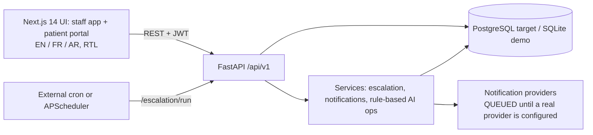

# OCTOLOOP — Technical Documentation (Future Health Digital Innovation Challenge)

## 1. Challenge statement addressed
Focus area: Population Health — "Closing the Screening-to-Care Loop".
**[TO FILL: paste the exact challenge statement text from the challenge page and tick off each "Your solution should" point in §7]**

## 2. Problem
People with an actionable screening result can be lost before they reach care. Without an owner,
a status and a due date per result, delays are invisible.

## 3. Solution
Every actionable result becomes a follow-up case moving through a 10-state journey:
Screening → Result review → Patient notification → Acknowledgement → Confirmatory testing →
Referral → Appointment → Consultation → Treatment/surveillance → Documented closure.
Each case has a responsible owner, priority, due date, full event timeline and multi-level escalation.

## 4. Architecture

- Backend: Python 3.12, FastAPI, SQLAlchemy 2, Pydantic, Alembic; 15+ tables.
- Frontend: Next.js 14 (App Router), TypeScript, Tailwind, Recharts.
- Deployment: Dockerfiles + docker-compose; `/health` and `/ready` probes.

## 5. AI components
Deterministic, offline, rule-based operational helpers (case summary, missing steps, overdue flags,
dashboard Q&A). Optional LLM path with PHI minimisation, timeout and deterministic fallback.
No diagnosis; humans close cases. Details: `docs/RESPONSIBLE_AI.md`.

## 6. Evaluation
- Software quality: 80 pytest tests (auth, RBAC, cases, screenings, referrals, appointments, portal isolation, population).
- **Impact page** (`/impact`): current metrics vs a baseline the user enters and sources (no pre-filled values).
- Impact metrics available in the app: screening→notification time, screening→consultation time,
  referral completion, lost-to-follow-up, overdue rate. All demo values are **synthetic and illustrative**.
- Not yet done: evaluation on real data, fairness analysis across groups, clinician validation.
  **[TO FILL: real feedback from health professionals and any real baseline]**

## 7. Mapping to the judging criteria
| Criterion | Where it is addressed |
|---|---|
| Health impact and clinical relevance | closed-loop workflow, metrics above, [TO FILL: validation] |
| Technical depth and architecture | §4, RBAC, token rotation, escalation engine, i18n/RTL |
| Working solution and demo | `docs/DEMO_SCRIPT_3MIN.md`, seeded demo, 5 demo accounts + portal |
| Responsible AI, safety, data governance | `docs/RESPONSIBLE_AI.md`, `docs/SECURITY.md` |
| Scalability and deployment readiness | Docker Compose, PostgreSQL target, probes |
| Commercial viability and path to pilot | `docs/COMMERCIAL_AND_PILOT.md` |

## 8. Assumptions
Synthetic data stands in for a real screening programme; a single site pilot is the first deployment;
notification gateway is provided by the pilot site or a provider.

## 9. Limitations
See README §9 (accurate, current list).

## 10. Roadmap
Small-cell suppression, consent/export/delete flows, real SMTP/SMS provider, FHIR-style export,
complete translation of page texts and backend-generated texts, PostgreSQL CI run.
